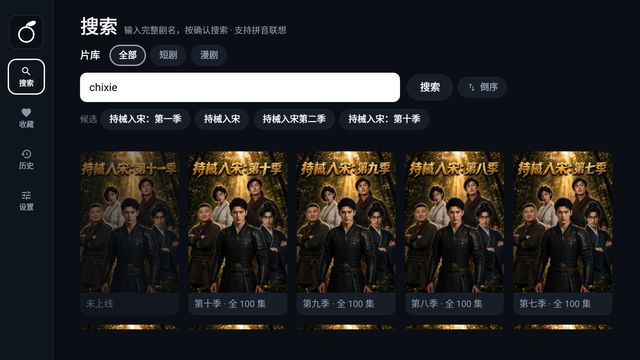
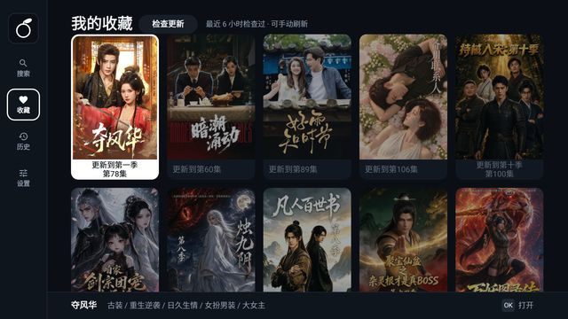
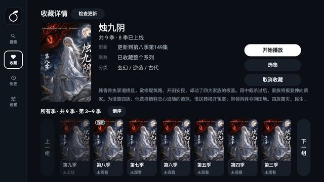
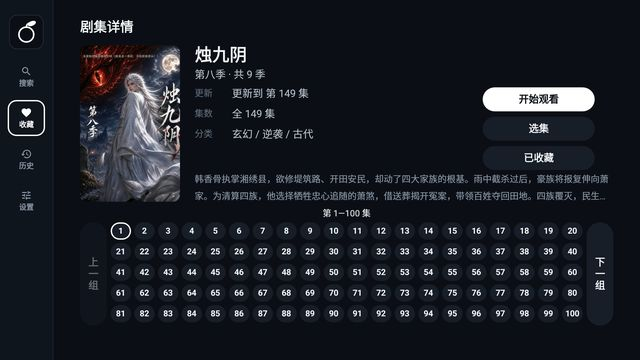

# HongGuo TV Lite

面向 Android TV 的非官方客户端，使用 Kotlin 与原生 View 实现，全程通过遥控器操作，最低支持 Android 6.0（API 23）。

本项目为**精简版（Lite）**：以已经验证可用的播放与交互实现为基础，只保留搜索、浏览、播放与本地数据能力；
相比上游移除了首页推荐、榜单、局域网与扫码服务等模块，并将代码重构为依赖方向受构建系统约束的结构，以降低后续维护成本。

## 免责声明

**本项目仅供个人技术学习与研究，禁止用于任何商业用途。**

本项目为非官方第三方客户端，与短剧平台及其运营方不存在隶属、合作或授权关系。

- 仓库仅包含客户端实现，不托管、不转存、不分发任何音视频内容；所有内容均由用户设备实时请求获得。
- 不包含账号登录、会员权益、付费内容绕过与去广告等相关实现。
- 使用者应自行确保使用行为符合所在地法律法规及平台服务条款。
- 作者不对因使用本项目产生的任何后果负责，亦不提供任何形式的担保。

## 功能

- 搜索：按剧名检索，使用官方网页的分页结果；输入完整剧名时聚合完整季线，支持正序与倒序；最近看过的几部直接在首页继续观看。
- 收藏：以「系列」为单位收藏，而非按单季收藏；最多 100 部，超出时替换最早收藏的一部；可在收藏页、选季页（多季）或剧集详情（单季）里检查更新。
- 历史：自动记录观看进度，保留最近 30 条，支持批量管理。
- 详情：展示封面、简介、分类与分集清单，分集按 20 列 × 5 行分页。
- 播放：支持断点续播、上下键切换集数、跨季连播、片尾预取下一集、失败自动重试与断网等待。
- 设置：清晰度、倍速、画面模式、自动连播、默认筛选、搜索顺序、启动页与清空观看记录。
- 更新：设置页页头按钮检查新版本，应用内下载，校验哈希、包名与签名后拉起安装器；按钮文案跟状态走（检查更新 / 下载新版 / 去安装 / 重试下载）。

## 界面

| 搜索                         | 收藏                            | 选季                            | 选集                              |
| -------------------------- | ----------------------------- | ----------------------------- | ------------------------------- |
|  |  |  |  |

## 范围之外

内容平台、离线下载（应用自身的更新包下载不在此列）、多端同步、排行榜、推荐流、弹幕与账号体系均不在本项目范围内，属于有意排除，而非尚未实现。

## 遥控器操作

| 范围   | 按键           | 行为                        |
| ---- | ------------ | ------------------------- |
| 全局   | 方向键 / 确定     | 移动光标 / 执行                 |
| 全局   | 返回           | 返回上一层；在目录页中先返回搜索页，再次按下才退出 |
| 历史页  | MENU         | 进入或退出管理状态（继续播放、删除）        |
| 播放页  | MENU         | 展开或收起底部抽屉（左侧选集，右侧播放设置）    |
| 播放页  | 左右方向键 / 长按右键 | 快退、快进 10 秒 / 2 倍速快进       |
| 播放页  | 上下方向键        | 切换上一集或下一集                 |
| 播放页  | 确定           | 暂停或继续                     |
| 播放抽屉 | 数字键          | 跳转到指定集数                   |

界面中有两种状态标识：白色填充表示光标所在位置，白色描边表示当前选中项，二者含义不同。

## 构建与验证

需要 JDK 17 与 Android SDK 36（含 build-tools 35.0.0，AGP 8.11 默认使用的版本）。目前仅在 Windows 环境完成验证。

```sh
# JAVA_HOME 指向 JDK 17，local.properties 中的 sdk.dir 指向 Android SDK
./gradlew :app:assembleDebug
```

提交前执行以下命令，将依次运行全部单元测试、六个 Android 模块的 lint 检查，并构建 debug 包：

```sh
./gradlew verify --console=plain
```

真实网络探针会真的请求上游接口，默认跳过；需要时单独运行（其余单测不在这一条命令里）：

```sh
# bash / macOS
HGTV_PROBE=1 ./gradlew :data:testDebugUnitTest --tests "com.hongguotv.lite.data.probe.*" --rerun-tasks
```

```powershell
# Windows PowerShell
$env:HGTV_PROBE = "1"; ./gradlew :data:testDebugUnitTest --tests "com.hongguotv.lite.data.probe.*" --rerun-tasks
```

正式签名需要 `keystore.properties`（不入库），也可通过 `HONGGUOTV_KEYSTORE`、`HONGGUOTV_STORE_PASSWORD`、`HONGGUOTV_KEY_ALIAS`、`HONGGUOTV_KEY_PASSWORD` 环境变量提供。

## 代码结构

项目由七个 Gradle 模块组成，依赖方向自上而下；违反该方向的引用会导致构建失败。

```
app                壳：Activity、导航、依赖组装
├── feature-catalog   搜索 / 收藏 / 历史 / 设置
├── feature-detail    详情 / 收藏系列
├── feature-player    播放页 / 抽屉 / 播放会话
├── uikit             设计令牌 / 控件 / 焦点图 / 页面骨架
├── data              网络 / 存储 / 取流 / 封面 / 日志的实现
└── core              纯 JVM：模型 / 接口 / 协议 / 用例
```

`uikit` 与 `data` 都依赖 `core`（`uikit` 以 `api` 方式导出，因此 `feature-*` 可以直接使用 `core` 的模型）；`core` 不依赖任何本工程模块。

上述结构由三条规则保证，均由构建系统校验，而非依赖开发者自觉：

1. `core` 不包含 Android SDK，导入 `android.*` 会直接编译失败，因此业务逻辑可以脱离设备完成单元测试。
2. 三个 feature 模块互不依赖，页面跳转统一通过 `Navigator` 完成。
3. 页面只依赖 `core.port` 中定义的接口，具体实现由 `app` 模块注入。

进一步阅读：[架构说明](docs/ARCHITECTURE.md)、[平台与 API 基线](docs/PLATFORM.md)、[界面与焦点规则](docs/UI/UI-RULES.md)。

## 设计取舍

- 采用原生 View 而非 Compose：目标设备为低配置电视盒子，优先保证焦点控制与内存占用可预期，而非开发效率。
- 最低版本为 Android 6.0：大量电视设备仍停留在 6.0，厂商少有升级意愿，因此从项目初期即按该基线编写，而非事后补充兼容。
- 不使用 SQLite，不提供下载与多端同步：项目由单人维护，范围越窄，长期维护的成本越低。

## 参与

1. 一次提交只处理一件事；格式化、重命名与行为变更分开提交。
2. 提交信息格式为 `类型: 中文摘要`，类型取 `feat` / `fix` / `refactor` / `test` / `chore`。
3. 不为通过构建而放宽模块边界，这一约束优先于任何单个功能的交付。

## 许可与出处

代码以 GPL-3.0-only 发布，全文见 [LICENSE](LICENSE)。

本项目派生自 [N3urda/hongguoTV](https://github.com/N3urda/hongguoTV)（GPL-3.0）：重新划分模块结构，重写数据层与季线逻辑，并移除不需要的功能。
内容请求相关实现移植自 [woshishiq1/drpys](https://github.com/woshishiq1/drpys)（GPL-3.0）；工程骨架思路源自 [@react-native-tvos/template-tv](https://github.com/react-native-tvos/template-tv)（MIT）。
完整的衍生关系、修改说明与依赖清单见 [NOTICE.md](NOTICE.md)。
